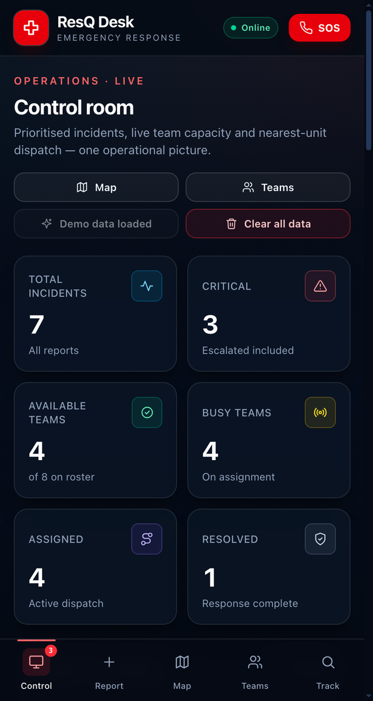
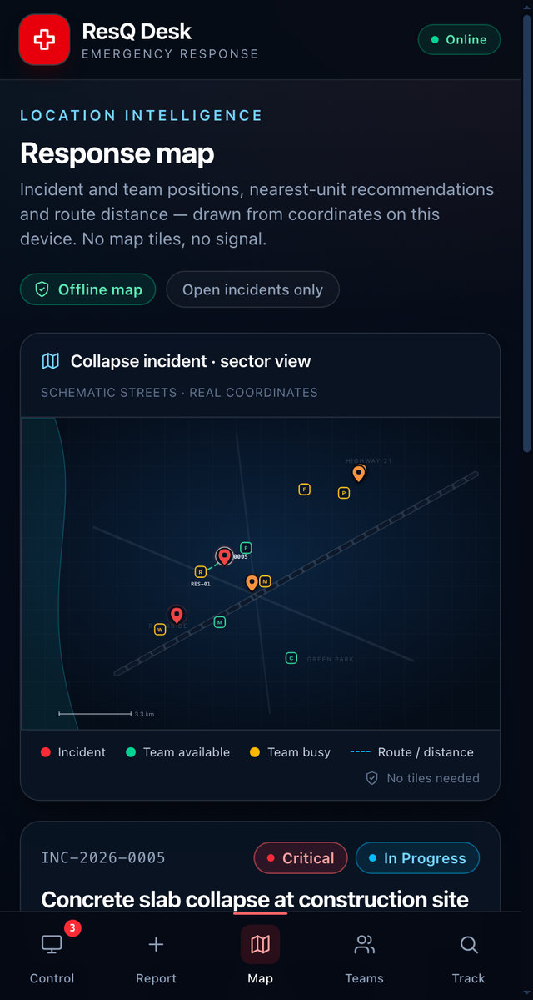
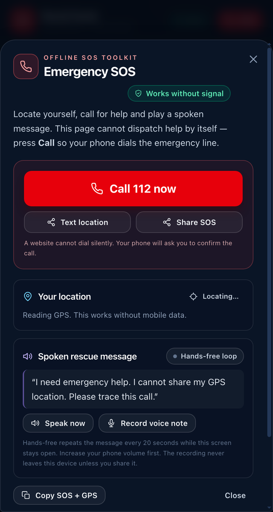

<div align="center">

# ResQ Desk

**Emergency response and disaster coordination that keeps working when the network doesn't.**

Report an emergency, triage it automatically, dispatch the nearest suitable team, follow the response on a map, and track it to resolution — all in the browser, with no backend, account or API key.

[](https://react.dev)
[](https://vite.dev)
[](https://tailwindcss.com)
[](#offline-first--installable-pwa)

Built for **Code Clash 2026 — Round 2: Emergency Response & Disaster Management Platform**.

</div>

<p align="center">
  
  
  
</p>

<p align="center"><sub>Control room · Offline response map · SOS toolkit</sub></p>

## Why ResQ Desk

Emergency coordination usually assumes reliable connectivity. ResQ Desk takes the opposite approach: the severity engine, team roster, distance calculations, dispatch and the map all run **on the device**. Once the app has loaded, losing the network does not take the control room down with it.

- **Local-first.** Incidents and teams live in `localStorage`; no server, sign-in or keys.
- **Explainable triage.** Every score shows exactly which factors produced it.
- **Dispatch with math.** Category matching plus real great-circle distance and a rough ETA.
- **Honest about limits.** The SOS toolkit prepares the call, message and location — it never pretends a website can silently dial 112.

## What it does

| Round 2 requirement | Implementation |
| --- | --- |
| **Intelligent incident prioritisation** | Deterministic severity engine scores category, people affected and risk keywords. Time since reporting adds up to **+20** to the dispatch priority, and unassigned reports auto-escalate one level every 10 minutes. The queue sorts by severity level, priority index, then oldest first. |
| **Response team management** | A full roster with team name, code, category, base location, GPS coordinates, phone number and live availability. Teams can be added, edited, removed, located with the device GPS and taken on/off duty. |
| **Nearest / suitable team assignment** | Only available, unassigned teams are considered. Category matches rank first, then shortest haversine distance. The UI shows every candidate's distance and ETA and highlights the best fit for one-tap dispatch. |
| **Assignment & lifecycle tracking** | `Reported → Assigned → In Progress → Resolved`, with a timestamped history entry for every change. Assigning marks the team busy; resolving releases it back to available. The public **Track** page shows the dispatched unit, distance and full timeline. |
| **Map / route visualisation** | A custom SVG map drawn from real coordinates — incident pins, team positions, selected route, distance, ETA, scale bar and a map queue. No tiles, geocoding API or network calls; the streets are illustrative, the coordinates and distances are real. |
| **Advanced analytics** | Total incidents, critical count, available teams, busy teams, active assignments and resolved incidents, plus category distribution, team readiness donut, critical-unassigned count, average time to dispatch and average resolution time. |

### Beyond the brief

- **Offline SOS toolkit** — GPS capture, one-tap emergency dialer, SMS/share sheet, spoken rescue message, hands-free repeat loop, 30-second voice note and copyable coordinates.
- **On-device triage assistant** — suggests a priority, responder type and immediate actions from the report text, without calling an AI API.
- **Duplicate detection** — warns when a similar incident was reported at the same place within the last hour and links the reports.
- **Installable PWA** — manifest, app icons and a service worker that serves the cached app shell when the network is slow or gone.
- **Mobile-first UI** — large touch targets, a five-tab bottom navigation bar and a live online/offline indicator.

## How prioritisation works

Severity is a transparent, repeatable score:

| Factor | Points |
| --- | --- |
| **Category** | Building collapse 35 · Fire 30 · Medical / Flood 25 · Road accident 20 · Other 10 |
| **People affected** | 1 person 5 · 2–5 people 10 · 6–15 people 20 · 16+ people 30 |
| **Risk keywords** | Up to 40 total — e.g. “trapped” 20, “unconscious” 25, “child / elderly / pregnant” 15, “explosion / gas leak / collapsing” 15, “bleeding / severe / burn” 10 |

The score maps to a level: **Low** under 30, **Medium** 30–49, **High** 50–74 and **Critical** 75+.

Two time rules sit on top:

1. **Dispatch priority** = severity score + `min(20, floor(minutes / 10) * 2)`. An incident that nobody has picked up slowly climbs the queue.
2. **Auto-escalation** — while an incident is still `Reported`, it gains one severity level per 10 minutes after a 10-minute grace period, up to Critical. The clock stops as soon as a team is assigned.

The incident modal exposes the complete breakdown, so a controller can see *why* something is Critical rather than trusting a black box.

## How dispatch works

1. Filter to teams that are **available** and have **no active assignment**.
2. Compute the haversine distance from each team's base to the incident.
3. Prefer teams whose category matches the incident; within each group, sort by distance.
4. Estimate arrival as `distance / 30 km/h + 2 minutes` of mobilisation.
5. Assigning writes the team to the incident, marks it busy and appends an `Assigned` history entry.
6. Resolving or releasing the incident returns the team to available.

On load, stored teams are reconciled against unresolved incidents so a refresh cannot leave a busy unit advertised as free.

## Offline-first & installable PWA

- The production build registers `public/sw.js`, which caches the app shell and falls back to it when a network request takes longer than 3.5 seconds or fails.
- `public/manifest.webmanifest` and the icons make the app installable to a phone home screen.
- Reports, severity scoring, team management, dispatch, the map, tracking and analytics all run locally and remain usable with the network off.
- The **online/offline** chip in the header reflects the browser's connectivity state.

> The service worker is intentionally network-first for navigation so a deployed update can be picked up, with the cached shell as the offline safety net.

## Offline SOS — and what a browser can honestly do

The SOS sheet is designed for the case where the person in danger cannot navigate the app:

- **Call 112 now** opens the phone dialer with the number filled in.
- **Text location** and **Share SOS** prepare a message containing coordinates and a short description.
- **Your location** reads GPS directly from the device — no data connection needed.
- **Speak now** reads a rescue message aloud; **Hands-free loop** repeats it every 20 seconds while the sheet stays open.
- **Record voice note** captures up to 30 seconds locally with `MediaRecorder`.
- **Copy SOS + GPS** puts the whole message on the clipboard.

**Important:** browsers cannot place a call or send an SMS silently, and Android/iOS developer options cannot bypass that restriction. The toolkit gets help one tap away and keeps speaking/recording if the user cannot interact further; it does not claim to dispatch rescue by itself.

## Tech stack

- **React 18** with Vite 5
- **Tailwind CSS 4** for styling
- **Recharts** for the category and team analytics charts
- **Hand-written SVG** for the coordinate map — no mapping library, tiles or API
- **Service worker + Web App Manifest** for offline/PWA support
- **localStorage** for persistence
- No backend, database, authentication, environment variables or third-party runtime services

## Getting started

Requires **Node.js 18+**.

```bash
npm install
npm run dev
```

Open <http://localhost:3000>.

The first visit starts empty. On the control room, press **Load demo data** to seed 7 incidents and 8 teams around Kochi, or report an incident yourself.

### Production build

```bash
npm run build
npm run preview
```

### Available scripts

| Script | Description |
| --- | --- |
| `npm run dev` | Start the Vite dev server on port 3000 |
| `npm run build` | Build the production bundle into `dist/` |
| `npm run preview` | Serve the production build locally |

## 2-minute demo

1. **Control room** — point out the prioritised queue, critical count, team readiness and analytics.
2. Open the **warehouse fire** — show the unassigned critical state, the “why this score” breakdown and the nearest-unit list.
3. **Assign the best-fit fire unit** — status becomes `Assigned`, the team becomes busy, and the history gets a timestamp.
4. **Response map** — select an incident and show the route, real distance, ETA and team positions.
5. **Response teams** — add a unit or show the roster, availability and assignments.
6. **Resolve** the incident — the team returns to available and the analytics update.
7. **SOS** — show GPS, the spoken message and the one-tap emergency call.
8. **Track** — look up `INC-2026-0001` to see the public timeline and dispatched team.

Use **Load demo data** to restore the seeded scenario and **Clear all data** to wipe incidents and teams from this browser.

## Project structure

```text
.
├── public/
│   ├── manifest.webmanifest   # PWA metadata
│   ├── sw.js                  # app-shell cache + offline fallback
│   └── icon-*.png             # installable app icons
├── src/
│   ├── App.jsx                # page shell, global state, dispatch handlers
│   ├── main.jsx               # React entry + service-worker registration
│   ├── index.css              # Tailwind entry and design tokens
│   ├── components/
│   │   ├── IncidentModal.jsx  # details, priority breakdown, assignment, history
│   │   ├── SOSSheet.jsx       # offline SOS toolkit
│   │   ├── CategoryChart.jsx
│   │   ├── TeamChart.jsx
│   │   └── ui.jsx             # shared icons, chips and primitives
│   ├── pages/
│   │   ├── ControlRoomPage.jsx
│   │   ├── ReportPage.jsx
│   │   ├── MapPage.jsx
│   │   ├── TeamsPage.jsx
│   │   └── TrackPage.jsx
│   └── lib/
│       ├── engine.js          # severity, priority, escalation, duplicates, storage
│       └── teams.js           # roster, haversine, ETA, ranking, reconciliation
├── docs/screenshots/          # README images
├── index.html
└── vite.config.js
```

## Data & privacy

Everything is stored under two `localStorage` keys in the current browser:

- `resq-desk.incidents.v1`
- `resq-desk.teams.v1`

Nothing is uploaded. There is no analytics, tracking or remote logging. Clearing site data or pressing **Clear all data** removes everything. Because storage is local, two devices do not share a control room.

## Safety & known limitations

- This is a coordination **demo**, not a live emergency service. In a real emergency, call the local emergency number first.
- The map is schematic: positions and distances are computed from real coordinates, but the street layout is illustrative and there is no routing around closures or traffic.
- Browsers cannot silently call or text emergency services; the SOS sheet always requires a confirming tap for the call.
- GPS accuracy depends on the device and permissions. Voice recording, speech synthesis and the screen wake lock depend on browser support.
- There is no backend, multi-device sync, authentication or role-based access. All data can be edited by anyone using the browser.
- Seeded coordinates are around Kochi, India, for demonstration only.
